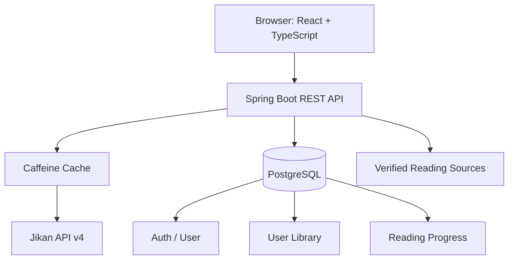

# PRD + Implementation Brief: Manga Reader Web MVP

> **Dokumen untuk coding agent**  
> Versi: 1.0  
> Status: Ready for implementation  
> Bahasa produk: Bahasa Indonesia  
> Prioritas: MVP-first  
> Metadata provider awal: Jikan API v4  
> Catatan penting: Jikan menyediakan metadata, bukan halaman/bab manga lengkap.

---

## 0. Instruksi Utama untuk Coding Agent

Baca seluruh dokumen ini sebelum mengubah kode. Tugas Anda bukan hanya memberikan rencana atau contoh kode: **inspeksi repository yang ada, implementasikan MVP secara bertahap, jalankan pemeriksaan dan test yang tersedia, lalu laporkan hasilnya secara jujur**.

### 0.1 Aturan kerja

1. Mulai dengan menginspeksi struktur repository, README, package/build files, konfigurasi, database migration, pola arsitektur, dan test yang sudah ada.
2. Jika repository telah memiliki stack atau konvensi, pertahankan dan sesuaikan PRD ini dengannya. Jangan mengganti framework atau menghapus implementasi yang valid tanpa alasan teknis yang jelas.
3. Jika repository kosong, gunakan stack rekomendasi di bagian 5.
4. Kerjakan fitur secara end-to-end: database/migration, backend, frontend, validasi, error handling, dan tests yang relevan.
5. Jangan berhenti setelah menulis rencana. Setelah inspeksi singkat, lanjutkan implementasi fitur prioritas sampai batas yang dapat diselesaikan dalam sesi ini.
6. Jangan mengarang endpoint Jikan, field response, data bab, URL gambar, hasil test, atau status deployment. Verifikasi kontrak Jikan pada dokumentasi resmi.
7. Jangan menganggap Jikan menyediakan daftar halaman gambar untuk membaca bab. Jangan membuat reader yang mengambil atau mem-proxy gambar dari situs lain tanpa izin.
8. Jangan menambahkan AniList pada MVP. Fokus pada Jikan untuk mengurangi kompleksitas dan menghindari risiko ketentuan penggunaan AniList terhadap aplikasi katalog/tracker.
9. Jangan memasukkan secret, password, token, atau kredensial ke source code.
10. Gunakan dependency yang stabil dan kompatibel dengan versi runtime repository. Hindari upgrade besar yang tidak diperlukan.
11. Gunakan environment variables untuk konfigurasi per lingkungan. Sediakan `.env.example` tanpa secret nyata jika diperlukan.
12. Setelah perubahan, jalankan build, lint, unit test, dan integration test yang tersedia. Jika suatu perintah tidak dapat dijalankan, jelaskan alasan dan jangan mengklaim lulus.
13. Pertahankan perubahan scoped pada kebutuhan MVP. Jangan menambahkan AI, komentar, notifikasi rilis bab, pembayaran, atau fitur sosial.
14. Jika ada keputusan kecil yang belum ditentukan, pilih opsi paling sederhana, aman, mudah dirawat, dan konsisten dengan dokumen ini. Catat asumsi penting pada ringkasan akhir; jangan berhenti untuk menanyakan hal yang tidak menghalangi implementasi.

### 0.2 Urutan eksekusi

- Tahap A: audit repository dan identifikasi perubahan yang diperlukan.
- Tahap B: bangun atau perbaiki integrasi Jikan dan katalog.
- Tahap C: implementasikan guest library dengan penyimpanan lokal.
- Tahap D: implementasikan autentikasi dan library/progres server-side.
- Tahap E: implementasikan sinkronisasi guest ke akun.
- Tahap F: implementasikan sumber bacaan berbentuk tautan yang diverifikasi, bukan pembajakan konten.
- Tahap G: jalankan test, cek keamanan dasar, perbaiki regresi, dan dokumentasikan hasil.

Jika proyek sudah memiliki implementasi untuk sebagian tahapan, audit dan gunakan kembali bagian yang benar-benar sesuai.

---

## 1. Ringkasan Produk

Manga Reader adalah aplikasi web responsif untuk menemukan manga melalui katalog metadata, mencari dan memfilter judul, melihat detail, serta mengelola daftar baca dan progres membaca.

MVP terdiri atas:

- Katalog manga dengan Jikan API v4.
- Pencarian, filter yang didukung API, pengurutan, dan pagination.
- Halaman detail manga.
- Guest mode yang menyimpan data daftar baca di browser.
- Akun pengguna untuk menyimpan daftar baca dan progres di PostgreSQL.
- Sinkronisasi data guest ke akun.
- Sumber bacaan berbentuk tautan resmi/terverifikasi.
- Arsitektur provider yang dapat diperluas untuk reader internal kelak, tetapi reader berbasis halaman/bab **tidak wajib diimplementasikan dalam MVP**.

### 1.1 Visi

Memberikan pengalaman penemuan dan pengelolaan manga yang rapi, cepat, responsif, serta siap dikembangkan menjadi reader untuk konten yang memang boleh ditampilkan.

### 1.2 Tujuan produk

1. Mempermudah pengguna menemukan manga.
2. Menampilkan metadata manga dengan konsisten dan toleran terhadap data yang tidak lengkap.
3. Memungkinkan pengguna menyimpan daftar baca tanpa harus membuat akun.
4. Memungkinkan pengguna terdaftar menyinkronkan daftar baca dan progres lintas perangkat.
5. Menghindari ketergantungan langsung frontend terhadap API eksternal.
6. Menjaga batas yang tegas antara metadata dan konten/halaman manga.
7. Menggunakan layanan gratis/open-source jika memungkinkan, dengan menyadari hosting dan database tetap dapat memiliki batas free tier.

### 1.3 Bukan tujuan MVP

- Menyediakan file/gambar tiap halaman manga dari Jikan.
- Menyalin atau melakukan mirror halaman manga dari situs pihak ketiga.
- Mengimplementasikan sistem rekomendasi AI.
- Sistem komentar, komunitas, atau rating buatan pengguna.
- Notifikasi otomatis bab baru.
- Pembayaran atau fitur premium.
- Download manga untuk offline.
- Upload konten oleh pengguna umum.
- Integrasi AniList.

---

## 2. Asumsi dan Keputusan Produk

| Area | Keputusan MVP |
|---|---|
| Metadata | Jikan API v4 sebagai satu provider awal |
| Format integrasi | Backend REST API untuk frontend; backend mengakses Jikan |
| Guest | Dapat menjelajahi katalog dan menyimpan daftar baca di browser |
| Akun | Email + password; kredensial dikelola secara aman |
| Sinkronisasi | Guest data digabungkan ke library akun setelah login/registrasi dengan aturan merge yang eksplisit |
| Database | PostgreSQL |
| UI | Responsive web, mobile-first, mudah digunakan dan accessible |
| Pembaca | MVP menampilkan tautan menuju sumber bacaan resmi/terverifikasi; reader internal penuh ditunda |
| Data bab | Jangan menyimpulkan daftar bab yang dapat dibaca hanya dari jumlah bab pada metadata |
| API lain | Jangan gunakan AniList dalam MVP |
| Hosting | Pilih free tier jika tersedia dan cocok; jangan menjanjikan hosting gratis permanen |

---

## 3. Pengguna dan Alur Utama

### 3.1 Guest

- Membuka beranda.
- Melihat daftar manga.
- Mencari/filter manga.
- Membuka detail.
- Menambahkan manga ke daftar lokal.
- Mengubah status membaca secara lokal.
- Memilih mendaftar/login untuk menyinkronkan data.

### 3.2 Pengguna terdaftar

- Registrasi atau login.
- Menjelajahi katalog.
- Menambahkan/menghapus manga dari library.
- Mengubah status membaca.
- Melihat riwayat/progres yang memang didukung aplikasi.
- Mengakses data yang sama setelah login di perangkat lain.
- Logout.

### 3.3 Admin (minimal, hanya bila diperlukan untuk source management)

- Login dengan role admin.
- Membuat/memperbarui tautan sumber bacaan.
- Mengatur status verifikasi dan aktif/nonaktif.
- Menyimpan referensi verifikasi/izin jika konten yang ditampilkan memerlukannya.
- Menonaktifkan sumber yang tidak lagi tersedia atau memiliki masalah izin.

Jika pengelolaan sumber belum perlu digunakan pada MVP awal, implementasikan model/kontrak dan halaman sederhana hanya jika ada persyaratan konkret. Jangan membuat sistem CMS besar.

---

## 4. Functional Requirements

### FR-01 — Beranda

Beranda menampilkan:

- Header dan navigasi utama.
- Kolom pencarian.
- Bagian manga populer/top jika endpoint Jikan yang tepat mendukungnya.
- Bagian manga terbaru atau pilihan lain hanya jika data tersebut benar-benar didukung endpoint.
- Grid kartu manga.
- Navigasi ke detail manga.
- Loading, empty, error, dan retry states.

Jangan menamai suatu bagian “rilis bab terbaru” kecuali tersedia sumber tepercaya untuk data bab/rilis. Jikan metadata saja tidak cukup untuk klaim tersebut.

### FR-02 — Katalog

Setiap kartu dapat menampilkan:

- Cover.
- Judul utama.
- Judul alternatif jika tersedia.
- Tipe (misalnya manga/manhwa/novel) jika field tersedia.
- Status publikasi jika tersedia.
- Skor jika valid.
- Genre jika tersedia dan layak ditampilkan ringkas.

Persyaratan:

- Pagination harus bekerja melalui backend.
- Jangan mengunduh seluruh katalog lalu melakukan pagination hanya di frontend.
- Field yang nullable tidak boleh merusak rendering.
- Cover yang gagal dimuat harus mempunyai fallback.
- Tampilkan skor hanya jika nilai bermakna menurut kontrak API; jangan menampilkan `0` sebagai skor valid jika itu menandakan tidak ada skor.

### FR-03 — Pencarian dan Filter

Dukungan minimum:

- Search berdasarkan judul menggunakan parameter Jikan yang didokumentasikan.
- Filter genre/status/tipe hanya jika didukung endpoint Jikan yang dipakai.
- Sorting berdasarkan field yang benar-benar tersedia.
- Pagination: page dan/atau limit sesuai kontrak upstream.
- Tombol reset filter.
- Empty state jika tidak ada hasil.
- Debounce input pencarian (sekitar 300–500 ms sebagai nilai awal yang dapat dikonfigurasi).
- Batalkan request lama jika pengguna mengubah query sebelum request selesai, jika teknologi mendukungnya.

Filter dan sorting harus divalidasi di backend. Jangan meneruskan parameter arbitrer pengguna secara langsung ke URL eksternal.

### FR-04 — Detail Manga

Tampilkan informasi yang tersedia:

- Judul utama, judul alternatif, cover.
- Sinopsis.
- Penulis/author jika tersedia.
- Genre dan tema.
- Tipe dan status publikasi.
- Jumlah bab/volume jika tersedia.
- Skor/popularitas jika tersedia.
- URL halaman informasi sumber metadata jika sesuai.
- Tombol tambah/hapus dari library.
- Status membaca pengguna.
- Tautan sumber bacaan terverifikasi jika ada.

Tidak boleh:

- Mengarang chapters dari `chapters` count.
- Menganggap jumlah bab berarti gambar bab tersedia.
- Membuat tombol “Baca sekarang” seolah reader internal tersedia ketika yang ada hanya tautan eksternal.
- Menampilkan tautan source yang dinonaktifkan atau belum lolos verifikasi.

### FR-05 — Integrasi Jikan API v4

Base URL awal: `https://api.jikan.moe/v4`.

Endpoint kandidat untuk diverifikasi terhadap dokumentasi aktual sebelum implementasi:

- `GET /manga` — katalog/pencarian manga.
- `GET /manga/{id}` — detail manga.
- `GET /top/manga` — daftar top manga, jika sesuai kebutuhan UI.
- `GET /genres/manga` — referensi genre, jika endpoint dan bentuk respons masih berlaku.

Panduan implementasi:

1. Buat satu client/provider khusus untuk Jikan.
2. Gunakan DTO eksternal tersendiri, jangan menggunakan DTO Jikan langsung sebagai kontrak API frontend.
3. Buat mapper dari respons Jikan ke domain model internal.
4. Tangani properti `null`, array kosong, dan field yang berubah/tidak tersedia.
5. Terapkan timeout dan batas koneksi yang masuk akal.
6. Hormati rate limit dan jangan mengirim request paralel berlebihan.
7. Tangani HTTP 400, 404, 429, 500, dan 503.
8. Tambahkan cache untuk hasil yang layak di-cache.
9. Jangan menyimpan salinan massal data eksternal; hanya cache seperlunya dan periksa ketentuan provider sebelum persistensi jangka panjang.
10. Log error teknis tanpa menyimpan data rahasia.
11. Jangan menganggap Jikan sebagai API autentikasi atau penyimpanan user list.
12. Jangan menganggap Jikan memberi izin terhadap semua artwork/cover yang direferensikan dalam respons.

Batas rate limit yang dipublikasikan Jikan dapat berubah; dokumentasi Jikan saat pemeriksaan mencantumkan 60 request/menit dan 3 request/detik, serta menyatakan respons di-cache di server Jikan selama 24 jam. Anggap angka ini sebagai batas upstream yang harus dicek kembali, bukan target trafik aplikasi. Terapkan limiter internal yang lebih konservatif dan dapat dikonfigurasi.

### FR-06 — Guest Mode

Guest dapat:

- Menggunakan katalog/pencarian/detail tanpa login.
- Menambahkan manga ke library lokal.
- Memilih status `READING`, `PLAN_TO_READ`, `COMPLETED`, `ON_HOLD`, atau `DROPPED`.
- Menghapus manga dari library lokal.
- Mempertahankan data setelah refresh pada browser yang sama.

Implementasi:

- Gunakan `localStorage` untuk daftar baca yang sederhana.
- Tambahkan `schemaVersion` pada struktur local storage.
- Validasi dan normalisasi data saat membaca local storage.
- Tangani JSON rusak, quota error, atau local storage yang tidak tersedia.
- Jangan menyimpan password/token akun di localStorage tanpa desain keamanan yang telah dievaluasi.
- Jika browser storage tidak tersedia, beri pesan yang jelas dan tetap izinkan katalog dipakai.

### FR-07 — Registrasi dan Autentikasi

MVP harus mendukung:

- Registrasi dengan email dan password.
- Login.
- Logout.
- Endpoint profil pengguna saat ini.
- Validasi email dan password di server.
- Email unik.
- Respons error yang konsisten dan tidak membocorkan informasi berlebihan.

Keamanan minimum:

- Password disimpan dalam bentuk hash dengan algoritma yang sesuai, misalnya BCrypt/Argon2 sesuai dukungan stack.
- Backend memeriksa autentikasi dan otorisasi untuk setiap endpoint privat.
- Identitas pengguna berasal dari principal/token terverifikasi, bukan `userId` yang dipercaya dari request body.
- Token/session tidak dimasukkan ke log.
- Jika memakai cookie session atau cookie JWT, konfigurasi `HttpOnly`, `Secure` untuk HTTPS, dan `SameSite` yang sesuai; evaluasi CSRF.
- Jika memakai bearer token, simpan dan refresh token dengan mempertimbangkan risiko XSS; jangan memilih strategi token tanpa dokumentasi singkat.
- Konfigurasikan CORS hanya untuk origin frontend yang dibutuhkan.
- Rate-limit endpoint login/registrasi secara proporsional.

### FR-08 — My Library untuk Akun

Status yang diizinkan:

- `READING`
- `PLAN_TO_READ`
- `COMPLETED`
- `ON_HOLD`
- `DROPPED`

Fungsi:

- Ambil library pengguna yang sedang login.
- Tambah entri.
- Ubah status.
- Hapus entri.
- Filter berdasarkan status di UI.
- Sort berdasarkan terakhir diperbarui atau tanggal ditambahkan.
- Mencegah duplikasi manga yang sama untuk akun sama.

Gunakan identitas stabil kombinasi provider + external ID, misalnya `JIKAN` + `malId`.

### FR-09 — Progres dan Riwayat Membaca

Karena Jikan bukan penyedia chapter reader, data progres hanya boleh digunakan jika aplikasi mengetahui progres dari sumber bacaan yang valid.

Model progres dapat mendukung:

- Manga provider dan ID.
- Sumber bacaan yang digunakan, jika ada.
- ID bab dari provider konten yang sah, nullable.
- Label bab yang diketahui, nullable.
- Indeks halaman/posisi scroll, nullable dan hanya relevan jika reader internal kelak tersedia.
- Waktu terakhir membaca.

MVP awal boleh menyediakan “terakhir dibuka”/history dari detail manga dan status library, tetapi jangan menampilkan “bab terakhir” jika tidak ada identitas bab yang valid.

### FR-10 — Sinkronisasi Guest ke Akun

Saat pengguna login/registrasi, tawarkan sinkronisasi library guest ke server.

Aturan merge default:

1. Gunakan key stabil `(provider, externalMangaId)`.
2. Jika entri lokal belum ada di server, buat entri server.
3. Jika entri sudah ada, jangan membuat duplikat.
4. Untuk status, gunakan aturan eksplisit: pilihan pengguna yang dibuat/diubah paling baru menang, bila timestamp tersedia dan tervalidasi. Jika timestamp tidak valid, pertahankan data server dan laporkan konflik dengan aman.
5. Progres hanya digabungkan jika merujuk pada source/chapter yang valid.
6. Server tetap melakukan validasi semua field.
7. Request sinkronisasi harus idempotent.
8. Jangan menghapus data guest sampai server mengonfirmasi penyimpanan sukses.
9. Jika sebagian item gagal, tampilkan ringkasan berhasil/gagal dan pertahankan data yang gagal agar dapat dicoba ulang.
10. Setelah sinkronisasi sukses, guest boleh memilih menghapus salinan lokal atau mempertahankan cache, tetapi jangan menghapus data sebelum konfirmasi sukses.

### FR-11 — Sumber Bacaan

MVP mendukung tautan ke sumber bacaan terverifikasi, bukan proxy/mirror konten.

Data source minimal:

- ID internal.
- Provider metadata + manga ID.
- Nama sumber.
- URL.
- Jenis: `OFFICIAL_LINK` atau `LICENSED_READER`.
- Status verifikasi: `PENDING`, `VERIFIED`, `REJECTED`.
- Flag aktif/nonaktif.
- Referensi lisensi/izin bila relevan.
- Timestamp pembuatan/pembaruan.

Ketentuan:

- URL harus divalidasi (HTTPS untuk sumber publik bila memungkinkan).
- Hindari open redirect; pengguna hanya boleh membuka URL sumber yang sudah tersimpan dan disetujui.
- Jangan scraping gambar/bab, bypass proteksi, atau men-proxy konten dari provider lain.
- Tidak ada reader internal aktif tanpa verifikasi hak penggunaan.
- Sediakan empty state “Sumber bacaan belum tersedia” jika tidak ada source yang lolos verifikasi.

### FR-12 — Admin Minimal

Jika fitur admin dibuat pada MVP:

- Hanya role `ADMIN` dapat mengelola sumber.
- Admin dapat membuat, memperbarui, mengaktifkan, dan menonaktifkan sumber.
- Status `VERIFIED` harus berasal dari tindakan administratif yang tercatat.
- Backend wajib mengotorisasi operasi; menyembunyikan tombol di frontend saja tidak cukup.
- Simpan `createdBy`/`updatedBy` bila sederhana dan relevan untuk audit.

### FR-13 — Masa Depan: Reader Provider

Siapkan batas arsitektur, bukan implementasi penuh.

Kontrak konseptual yang bisa dipertimbangkan:

- `getAvailableChapters(mangaKey)`
- `getChapter(chapterKey)`
- `getAuthorizedPages(chapterKey)`
- `checkAvailability(sourceKey)`

Nama di atas merupakan konsep internal dan tidak boleh diklaim sebagai endpoint Jikan.

Implementasi nyata hanya boleh ditambahkan setelah ada source legal/berizin serta kontrak teknis yang jelas. Jangan membuat mock data yang seolah konten sungguhan tersedia dalam production.

---

## 5. Rekomendasi Stack (Jika Repository Kosong)

| Lapisan | Teknologi |
|---|---|
| Frontend | React + TypeScript + Vite |
| UI | Tailwind CSS atau styling yang sudah ada di repository |
| Backend | Java + Spring Boot |
| REST | Spring Web |
| Validation | Jakarta Bean Validation |
| Security | Spring Security |
| Persistence | Spring Data JPA |
| Database | PostgreSQL |
| Migration | Flyway |
| Metadata client | Spring `RestClient` atau `WebClient`, pilih salah satu sesuai kebutuhan |
| Cache | Caffeine untuk cache lokal MVP |
| API documentation | Springdoc OpenAPI jika kompatibel dengan versi Spring Boot |
| Frontend tests | Vitest + React Testing Library |
| Backend tests | JUnit + Spring Boot Test; Testcontainers hanya jika environment mendukungnya |
| Local development | Docker Compose opsional untuk PostgreSQL |

Catatan:

- Jangan tambahkan Redis sebelum ada kebutuhan multi-instance yang jelas.
- Jangan membutuhkan paid API key.
- Jangan memilih hosting/database free tier tanpa membaca limit, sleeping policy, storage limit, dan ketentuan terkininya.
- Gunakan versi dependency yang kompatibel dengan versi Java dan Spring Boot repository.

---

## 6. Arsitektur yang Diharapkan



### Prinsip arsitektur

1. Browser tidak memanggil Jikan langsung untuk data inti aplikasi; gunakan backend sebagai facade agar cache, normalisasi, dan rate limiting terpusat.
2. Frontend menggunakan kontrak API internal, tidak bergantung pada struktur JSON Jikan.
3. Data library/progres merupakan data aplikasi dan disimpan di PostgreSQL untuk akun.
4. Data guest dapat disimpan di browser.
5. Metadata eksternal tidak wajib disalin permanen ke database; simpan cache seperlunya sesuai kebutuhan dan ketentuan layanan.
6. Provider metadata dan provider sumber bacaan harus dipisahkan.
7. Jangan menyimpan data manga eksternal secara massal untuk dijadikan backup pengganti provider.
8. Jangan mengimplementasikan scraping konten manga.

### Struktur package backend yang disarankan

Sesuaikan dengan konvensi yang sudah ada. Jika proyek baru:

```text
com.example.mangareader
├── auth
├── user
├── manga
│   ├── api
│   ├── application
│   ├── domain
│   └── integration
│       └── jikan
├── library
├── readingprogress
├── readingsource
├── admin
└── common
    ├── config
    ├── exception
    ├── response
    └── pagination
```

Gunakan DTO untuk request/response, service untuk logic bisnis, repository untuk persistence, dan client khusus untuk integrasi eksternal.

---

## 7. Model Data PostgreSQL

Sesuaikan tipe dan naming dengan konvensi repository. Gunakan migration Flyway dan constraint database; jangan hanya mengandalkan validasi frontend.

### 7.1 `users`

| Kolom | Tipe awal | Ketentuan |
|---|---|---|
| `id` | UUID | Primary key |
| `email` | VARCHAR(254) | Wajib, unique, normalized lowercase |
| `password_hash` | VARCHAR | Wajib; hash, bukan plaintext |
| `display_name` | VARCHAR(100) | Wajib atau fallback yang jelas |
| `role` | VARCHAR(20) | `USER` atau `ADMIN` |
| `created_at` | TIMESTAMPTZ | Waktu UTC |
| `updated_at` | TIMESTAMPTZ | Waktu UTC |

### 7.2 `user_library`

| Kolom | Tipe awal | Ketentuan |
|---|---|---|
| `id` | UUID | Primary key |
| `user_id` | UUID | FK ke `users.id`, not null |
| `provider` | VARCHAR(30) | Contoh `JIKAN` |
| `external_manga_id` | BIGINT | ID manga pada provider |
| `reading_status` | VARCHAR(30) | Enum status yang diizinkan |
| `added_at` | TIMESTAMPTZ | Waktu ditambahkan |
| `created_at` | TIMESTAMPTZ | Waktu pembuatan |
| `updated_at` | TIMESTAMPTZ | Waktu pembaruan |

Constraint:

- Unique `(user_id, provider, external_manga_id)`.
- Index untuk `(user_id, reading_status)`.
- FK user valid.

### 7.3 `reading_progress`

| Kolom | Tipe awal | Ketentuan |
|---|---|---|
| `id` | UUID | Primary key |
| `user_id` | UUID | FK ke `users.id`, not null |
| `provider` | VARCHAR(30) | Provider metadata, misalnya `JIKAN` |
| `external_manga_id` | BIGINT | ID manga eksternal |
| `reading_source_id` | UUID | FK source, nullable |
| `chapter_external_id` | VARCHAR(255) | Nullable; harus berasal dari source yang sah |
| `chapter_label` | VARCHAR(100) | Nullable |
| `page_index` | INTEGER | Nullable, tidak boleh negatif |
| `scroll_position` | NUMERIC | Nullable, divalidasi bila digunakan |
| `last_read_at` | TIMESTAMPTZ | Nullable |
| `updated_at` | TIMESTAMPTZ | Waktu perubahan |

Constraint:

- Unique `(user_id, provider, external_manga_id)` untuk satu progres terakhir per manga.
- FK `reading_source_id` jika source dihapus harus ditangani dengan kebijakan yang jelas.
- Jangan menyimpan `chapter_external_id` fiktif.

### 7.4 `reading_sources`

| Kolom | Tipe awal | Ketentuan |
|---|---|---|
| `id` | UUID | Primary key |
| `provider` | VARCHAR(30) | Provider metadata |
| `external_manga_id` | BIGINT | ID manga terkait |
| `source_name` | VARCHAR(150) | Nama penyedia |
| `source_url` | TEXT | URL yang telah divalidasi |
| `source_type` | VARCHAR(30) | `OFFICIAL_LINK` atau `LICENSED_READER` |
| `verification_status` | VARCHAR(20) | `PENDING`, `VERIFIED`, `REJECTED` |
| `license_reference` | TEXT | Nullable; referensi izin/dokumen, bukan asumsi izin |
| `is_active` | BOOLEAN | Default false sampai diverifikasi |
| `created_by` | UUID | Nullable FK user/admin |
| `created_at` | TIMESTAMPTZ | Waktu pembuatan |
| `updated_at` | TIMESTAMPTZ | Waktu pembaruan |

### 7.5 `metadata_cache` (Opsional)

Gunakan Caffeine sebagai cache utama pada MVP awal. Jangan menambahkan tabel metadata persisten kecuali memang dibutuhkan oleh kebutuhan, ketentuan provider, atau fitur yang disepakati. Jika menyimpan metadata eksternal, persistensi harus terbatas, terdokumentasi, dan mengikuti syarat penggunaan sumber data.

### 7.6 Guest Library

Guest library berada di browser, tidak memerlukan tabel guest di server pada MVP. Gunakan key local storage yang berversi, misalnya `manga-reader:guest-library:v1`.

Data guest minimal:

```json
{
  "schemaVersion": 1,
  "items": [
    {
      "provider": "JIKAN",
      "externalMangaId": 11,
      "titleSnapshot": "Example Title",
      "coverUrlSnapshot": null,
      "readingStatus": "PLAN_TO_READ",
      "addedAt": "2026-01-01T00:00:00.000Z",
      "updatedAt": "2026-01-01T00:00:00.000Z"
    }
  ]
}
```

Contoh ini hanya menjelaskan struktur; gunakan data yang benar-benar berasal dari provider dan jangan hardcode contoh sebagai manga nyata.

---

## 8. Kontrak REST API Internal

Gunakan prefix `/api/v1`. Sesuaikan implementasi jika repository mempunyai konvensi API yang sudah ada.

| Method | Endpoint | Auth | Tujuan |
|---|---|---|---|
| `GET` | `/api/v1/manga` | Public | Katalog, search, filter, pagination |
| `GET` | `/api/v1/manga/{id}` | Public | Detail manga berdasarkan Jikan ID |
| `GET` | `/api/v1/manga/top` | Public | Top manga jika UI memerlukannya |
| `GET` | `/api/v1/genres` | Public | Genre yang didukung |
| `POST` | `/api/v1/auth/register` | Public | Registrasi |
| `POST` | `/api/v1/auth/login` | Public | Login |
| `POST` | `/api/v1/auth/logout` | Auth/session | Logout jika dibutuhkan model auth |
| `GET` | `/api/v1/users/me` | Private | Profil pengguna aktif |
| `GET` | `/api/v1/library` | Private | Daftar baca |
| `POST` | `/api/v1/library` | Private | Tambah item |
| `PATCH` | `/api/v1/library/{id}` | Private | Ubah status |
| `DELETE` | `/api/v1/library/{id}` | Private | Hapus item |
| `GET` | `/api/v1/reading-progress` | Private | Progres pengguna |
| `PUT` | `/api/v1/reading-progress/{provider}/{mangaId}` | Private | Upsert progres valid |
| `POST` | `/api/v1/sync/guest-library` | Private | Merge guest library |
| `GET` | `/api/v1/reading-sources/{provider}/{mangaId}` | Public | Source aktif dan terverifikasi |

### 8.1 Query katalog

Rancangan query internal dapat menggunakan:

- `q`: teks pencarian.
- `genre`: ID genre yang didukung.
- `status`: status valid yang didukung upstream.
- `type`: tipe yang didukung upstream.
- `orderBy`: allowlist field sorting.
- `sort`: `asc`/`desc` bila didukung kombinasi yang diminta.
- `page`: nomor halaman minimal 1.
- `limit`: ukuran halaman dalam batas maksimum yang ditentukan aplikasi.

Backend wajib memetakan parameter internal ke parameter Jikan yang benar sesuai dokumentasi aktual. Jangan meneruskan parameter mentah tanpa validasi.

### 8.2 Format respons

Gunakan satu kontrak respons yang konsisten dengan konvensi repository. Contoh konseptual:

```json
{
  "success": true,
  "data": {},
  "pagination": {
    "page": 1,
    "limit": 20,
    "hasNext": false
  },
  "error": null
}
```

Jika repository sudah mempunyai `CommonResponse` atau wrapper setara, gunakan kembali daripada membuat wrapper kedua.

### 8.3 Format error

Error harus mempunyai status HTTP yang benar dan pesan yang tidak membocorkan stack trace. Kode error internal yang direkomendasikan:

- `VALIDATION_ERROR`
- `NOT_FOUND`
- `UNAUTHORIZED`
- `FORBIDDEN`
- `CONFLICT`
- `UPSTREAM_RATE_LIMITED`
- `UPSTREAM_UNAVAILABLE`
- `INTERNAL_ERROR`

Jangan mengirim exception stack trace atau raw error upstream kepada browser production.

---

## 9. Caching, Rate Limiting, dan Integrasi Jikan

### 9.1 Strategi cache

- Cache detail manga berdasarkan provider + ID.
- Cache genre yang jarang berubah.
- Cache query katalog berdasarkan parameter yang sudah dinormalisasi.
- Gunakan TTL terkonfigurasi; jangan menganggap semua data mempunyai frekuensi perubahan sama.
- Jangan cache response error sebagai data valid.
- Sertakan kebijakan stale cache saat upstream tidak tersedia jika aman.
- Cache lokal Caffeine cukup untuk MVP single instance; cache multi-instance dapat dipertimbangkan kemudian.

### 9.2 Rate limit internal

- Terapkan limiter konservatif di backend.
- Batasi concurrency request upstream.
- Hindari satu request Jikan untuk setiap render komponen.
- Debounce input search.
- Hindari request berulang saat route berubah kecil atau komponen re-render.
- Hormati response `429` dan header retry jika tersedia.
- Gunakan exponential backoff dengan batas retry kecil untuk error sementara yang layak di-retry.
- Jangan retry agresif untuk HTTP 400 atau 404.

### 9.3 Mapping dan fallback

- Field eksternal nullable.
- Validasi dan normalisasi URL cover.
- Jika score `0` berarti belum ada skor pada kontrak upstream, tampilkan “Belum ada skor” atau sembunyikan skor.
- Genre kosong harus menghasilkan tampilan yang wajar.
- Tanggal dan status tak dikenal tidak boleh menyebabkan exception.
- Simpan ID eksternal sebagai ID provider, jangan dianggap sebagai UUID internal.

### 9.4 Uji integrasi

Gunakan mock/stub untuk unit dan test otomatis. Jangan membuat test suite bergantung pada availability Jikan setiap kali berjalan. Tambahkan smoke test opsional yang bisa dijalankan manual dengan flag/konfigurasi terpisah.

---

## 10. UI/UX Requirements

### 10.1 Prinsip desain

- Mobile-first, responsif pada mobile/tablet/desktop.
- Visual modern, rapi, fokus pada cover dan informasi manga.
- Pastikan teks mempunyai kontras yang baik.
- Sediakan loading skeleton atau indikator loading.
- Sediakan empty state dan error state yang jelas.
- Jangan gunakan terlalu banyak efek dekoratif yang mengganggu membaca.
- Navigasi utama: Beranda, Jelajahi, My Library, Login/Profil.
- Guest tetap bisa menggunakan katalog.
- Tampilan kartu memiliki rasio cover konsisten dan fallback untuk gambar rusak.

### 10.2 Halaman minimum

1. `/` — Beranda.
2. `/manga` — Katalog, pencarian, filter.
3. `/manga/:id` — Detail manga.
4. `/library` — Daftar baca lokal atau akun.
5. `/login` — Login.
6. `/register` — Registrasi.
7. `/profile` — Profil/logout, jika relevan.
8. `/admin/sources` — hanya jika source management admin masuk implementasi.

### 10.3 Aksesibilitas

- Input memiliki label.
- Tombol dapat digunakan dengan keyboard.
- Focus state terlihat.
- Gambar cover memiliki alt text yang sesuai.
- Status/error tidak hanya dibedakan berdasarkan warna.
- Dialog konfirmasi dapat ditutup dengan keyboard dan memiliki focus management yang sesuai.

### 10.4 Responsif

- Grid menyesuaikan lebar layar.
- Filter pada mobile dapat disajikan melalui drawer/sheet yang accessible.
- Tombol sentuh cukup besar.
- Tidak ada horizontal overflow pada lebar mobile standar.
- Pagination tetap dapat digunakan di layar kecil.

---

## 11. Non-Functional Requirements

### NFR-01 Performance

- Gunakan pagination upstream/backend.
- Gunakan image lazy loading.
- Hindari N+1 request metadata.
- Target awal untuk katalog menggunakan cache: konten utama tampil dalam ≤2,5 detik pada p75 pada environment pengujian yang didefinisikan. Catat hasil aktual; jangan klaim tanpa pengukuran.

### NFR-02 Reliability

- Aplikasi tidak crash ketika Jikan down.
- Timeout upstream harus dikonfigurasi.
- Tampilkan pesan yang dapat dimengerti pengguna.
- Gunakan cache fallback jika sesuai.
- Error eksternal tidak boleh membocorkan stack trace.

### NFR-03 Security

- Enforce auth/authorization server-side.
- Hash password.
- Validasi input.
- CORS dibatasi.
- Cegah SQL injection lewat parameterized queries/JPA.
- Escape/sanitize output sesuai konteks untuk mencegah XSS.
- Lindungi alur cookie/session terhadap CSRF sesuai desain.
- Rate-limit auth endpoints.
- Tidak ada secret di Git.

### NFR-04 Privacy

- Simpan hanya data yang diperlukan.
- Jelaskan bahwa guest library disimpan dalam browser.
- Sediakan penghapusan akun/data yang wajar jika didukung MVP.
- Jangan mengirim daftar baca pribadi ke provider eksternal.

### NFR-05 Maintainability

- Pisahkan controller, service, repository, DTO, domain model, dan external client.
- Gunakan Flyway untuk perubahan skema.
- Jangan ubah schema database manual tanpa migration yang disertakan.
- Dokumentasikan cara menjalankan aplikasi.
- Tambahkan test pada business logic dan security-sensitive code.

### NFR-06 Observability

- Log error integrasi, response time, dan status upstream tanpa secret.
- Sertakan correlation/request ID jika pola proyek mendukungnya.
- Pantau request Jikan, cache hit/miss, dan error rate jika mudah dilakukan.

---

## 12. Batasan Hak Cipta, Konten, dan Penggunaan API

1. Metadata API tidak otomatis memberikan hak untuk memublikasikan ulang artwork, cover, atau halaman manga.
2. Jangan scrape, mirror, men-proxy, mengunduh massal, atau mendistribusikan ulang chapter dari situs lain tanpa izin yang sesuai.
3. Jangan melakukan bypass login, paywall, DRM, anti-hotlinking, atau mekanisme perlindungan provider.
4. Gunakan URL sumber resmi untuk mengarahkan pengguna ke penyedia bacaan yang berwenang.
5. Reader internal hanya boleh menampilkan karya sendiri atau konten yang memiliki izin sesuai kebutuhan penggunaan.
6. Simpan catatan sumber/verifikasi izin jika perlu, dan sediakan tombol nonaktif untuk sumber bermasalah.
7. Periksa syarat API dan penggunaan gambar saat implementasi dan sebelum deployment karena bisa berubah.
8. Jikan tidak berafiliasi dengan MyAnimeList. Developer bertanggung jawab menaati ketentuan Jikan dan MyAnimeList yang berlaku.
9. Ketentuan AniList saat ini membatasi penggunaan API pada layanan yang bersaing dan tidak komplementer, termasuk manga/anime list tracker. Karena aplikasi ini punya katalog dan library, AniList tidak dipakai dalam MVP kecuali kelak ada konfirmasi izin yang sesuai.
10. Lisensi kode Jikan tidak otomatis menjadi lisensi data maupun artwork milik pihak ketiga.

Jika hak penggunaan konten tidak jelas, jangan aktifkan fitur display konten. Gunakan tautan menuju situs resmi.

---

## 13. Acceptance Criteria

### AC-01 Katalog

- [ ] Beranda berhasil memuat data manga melalui backend jika Jikan tersedia.
- [ ] Loading, error, empty state, dan retry berfungsi.
- [ ] Cover rusak/missing memiliki fallback.
- [ ] Field nullable tidak membuat halaman crash.
- [ ] Pagination benar dan bukan pagination client-side atas katalog lengkap.

### AC-02 Search/filter

- [ ] Search menghasilkan query backend yang benar.
- [ ] Debounce mencegah request berlebihan.
- [ ] Filter hanya menawarkan opsi yang didukung API.
- [ ] Reset filter mengembalikan state awal.
- [ ] Empty result tampil dengan benar.
- [ ] Parameter invalid ditolak/dinormalisasi di backend.

### AC-03 Detail

- [ ] Detail berdasarkan external ID dapat dimuat.
- [ ] Data opsional tampil dengan fallback.
- [ ] Tidak ada daftar chapter/gambar yang dikarang.
- [ ] Tautan source hanya tampil jika aktif dan terverifikasi.

### AC-04 Guest library

- [ ] Guest bisa menambah, mengubah status, dan menghapus manga.
- [ ] Data bertahan setelah refresh pada browser sama.
- [ ] Aplikasi bertahan jika localStorage rusak/tidak tersedia.
- [ ] Guest tidak mengakses endpoint privat.

### AC-05 Auth

- [ ] Registrasi berhasil dengan input valid.
- [ ] Email duplikat ditolak.
- [ ] Login/logout bekerja.
- [ ] Password tidak disimpan plaintext.
- [ ] Endpoint privat menolak pengguna tanpa auth.
- [ ] Pengguna A tidak dapat membaca atau mengubah data pengguna B.

### AC-06 Library akun

- [ ] Item dapat ditambah, diubah status, dan dihapus.
- [ ] Unique constraint mencegah entri duplikat.
- [ ] Library bertahan setelah logout/login.
- [ ] Pagination/filter library (jika disertakan) berjalan konsisten.

### AC-07 Sinkronisasi

- [ ] Data guest dapat dimasukkan ke akun.
- [ ] Request berulang tidak membuat duplikat.
- [ ] Local data tidak dihapus sebelum server berhasil menyimpan.
- [ ] Konflik status/progres mengikuti aturan merge yang terdokumentasi.
- [ ] Partial failure dilaporkan dan dapat dicoba ulang.

### AC-08 Jikan resilience

- [ ] HTTP 429 ditangani tanpa retry agresif.
- [ ] Timeout/upstream 5xx tidak membuat server crash.
- [ ] Cache dipakai sesuai TTL.
- [ ] Unit/integration tests menggunakan mock, bukan mengandalkan jaringan eksternal.
- [ ] Konfigurasi base URL/timeout/cache mudah diatur.

### AC-09 Security & content

- [ ] Akses admin dicek server-side.
- [ ] CORS dikonfigurasi secara eksplisit.
- [ ] Tidak ada secret di repository.
- [ ] Tidak ada gambar/chapter pihak ketiga yang di-host ulang tanpa izin.
- [ ] Source dapat dinonaktifkan.

### AC-10 Delivery

- [ ] Aplikasi dapat dijalankan mengikuti README.
- [ ] Migration database berjalan dari database kosong.
- [ ] Format/lint/build/test yang tersedia dijalankan.
- [ ] Hasil aktual dicantumkan dalam laporan final.

---

## 14. Strategi Testing

### Backend unit tests

- Mapping response Jikan.
- Normalisasi query dan allowlist sorting.
- Pemetaan error upstream.
- Validasi status library.
- Aturan merge guest library.
- Otorisasi operasi library/source.
- Penanganan nullable/field data eksternal yang tidak lengkap.

### Backend integration tests

- Repository/database dan migration.
- Registrasi/login.
- Akses endpoint privat.
- CRUD library.
- Upsert progress.
- Idempotensi sinkronisasi.
- Integrasi client Jikan menggunakan mock server/stub.

### Frontend tests

- Kartu manga menangani cover/field kosong.
- Search debounce dan filter.
- Loading/error/empty state.
- Guest library CRUD.
- Registrasi/login form validation.
- Merge confirmation dan handling sync error.

### End-to-end smoke tests

1. Buka beranda.
2. Cari manga.
3. Buka halaman detail.
4. Tambahkan ke guest library.
5. Refresh dan pastikan item tetap ada.
6. Buat akun/login.
7. Sinkronkan guest library.
8. Reload library akun dan pastikan data muncul.
9. Logout dan pastikan endpoint privat tidak dapat diakses.
10. Simulasikan Jikan unavailable dan verifikasi aplikasi menampilkan fallback.

---

## 15. Tahapan Implementasi dan Definition of Done per Tahap

### Tahap 0 — Audit repository

Tugas:

- Identifikasi stack, entry points, struktur modul, style conventions, scripts, migrations, dan tests.
- Periksa versi Java/Node/build tool dari repository.
- Identifikasi fitur yang sudah ada agar tidak dibuat ulang.
- Buat daftar perubahan singkat, lalu langsung implementasikan tahap berikutnya.

DoD:

- Ringkasan audit singkat.
- Keputusan integrasi mengikuti arsitektur yang sudah ada jika layak.

### Tahap 1 — Backend foundation dan Jikan client

Tugas:

- Konfigurasi base URL Jikan, timeout, cache, dan error mapping.
- Implementasikan DTO eksternal dan domain response.
- Buat endpoint katalog, detail, top, dan genre yang benar-benar diperlukan.
- Tambahkan validasi query dan pagination.
- Tambahkan test untuk mapping/error/validation.

DoD:

- Endpoint bekerja dengan mock integration tests.
- Error upstream tidak menyebabkan server crash.
- Tidak ada integrasi langsung frontend-to-Jikan untuk alur utama.

### Tahap 2 — Frontend catalog

Tugas:

- Buat layout responsif.
- Buat beranda, katalog, search/filter, pagination, detail.
- Buat loading/error/empty states.
- Tangani data nullable dan gambar gagal.
- Buat komponen reusable untuk kartu manga dan metadata.

DoD:

- Fitur katalog lengkap dengan data backend.
- Tidak ada hardcoded daftar manga untuk menggantikan API dalam production.

### Tahap 3 — Guest library

Tugas:

- Definisikan schema localStorage berversi.
- Implementasikan add/update/remove dan status.
- Tambahkan migrasi schema sederhana atau fallback version handling.
- Tangani storage errors.

DoD:

- Data guest bertahan setelah refresh.
- Unit tests untuk CRUD, data rusak, dan duplicate.

### Tahap 4 — Authentication dan persistence akun

Tugas:

- Tambahkan user migration/entity/repository.
- Registrasi/login/logout dan keamanan sesuai model auth.
- Tambahkan tabel library/progress.
- Implementasikan endpoint privat dan ownership checks.
- Buat UI auth dan library akun.

DoD:

- Pengguna dapat mengelola library miliknya.
- Akses lintas pengguna diuji dan ditolak.

### Tahap 5 — Guest sync

Tugas:

- Implementasikan kontrak sync request/response.
- Terapkan merge yang idempotent.
- Pertahankan data lokal sampai server mengonfirmasi.
- Tangani konflik/partial failure.

DoD:

- Test sync insert, duplicate, merge status, failure, dan retry lulus.

### Tahap 6 — Reading source

Tugas:

- Tambahkan model dan endpoint source jika termasuk scope saat ini.
- Validasi URL dan status.
- Pastikan hanya source aktif/terverifikasi terlihat oleh guest.
- Batasi pengelolaan source ke admin.

DoD:

- Tidak ada internal reader palsu.
- Tidak ada fetch atau mirror chapter image dari provider pihak ketiga tanpa izin.

### Tahap 7 — Stabilization dan dokumentasi

Tugas:

- Jalankan format/lint/build/test.
- Perbaiki seluruh regresi yang ditemukan.
- Verifikasi migration pada database kosong jika environment memungkinkan.
- Perbarui README dan `.env.example`.
- Dokumentasikan endpoints, run instructions, dan known limitations.

DoD:

- Perintah lokal terdokumentasi.
- Laporan status test akurat.
- TODO/limitasi yang belum selesai dicatat.

---

## 16. Environment dan Developer Experience

Sediakan `.env.example` atau konfigurasi setara, contohnya:

```dotenv
# Backend
SPRING_PROFILES_ACTIVE=local
SERVER_PORT=8080

# PostgreSQL - gunakan nilai lokal/non-production pada contoh
DB_HOST=localhost
DB_PORT=5432
DB_NAME=manga_reader
DB_USERNAME=postgres
DB_PASSWORD=change-me-locally

# Jikan
JIKAN_BASE_URL=https://api.jikan.moe/v4
JIKAN_CONNECT_TIMEOUT_MS=3000
JIKAN_READ_TIMEOUT_MS=5000
JIKAN_CACHE_TTL_SECONDS=3600
JIKAN_MAX_REQUESTS_PER_MINUTE=30

# Frontend
VITE_API_BASE_URL=http://localhost:8080/api/v1
```

Sesuaikan nama variable dengan framework dan konfigurasi existing. Nilai contoh tidak boleh digunakan sebagai kredensial produksi. Batas request internal harus konservatif dan disesuaikan dari hasil pengujian serta ketentuan provider.

Jika menggunakan Docker Compose untuk local PostgreSQL, buat volume persisten dan healthcheck. Jangan menjadikan Docker wajib jika repository sudah memakai cara lain yang sederhana.

---

## 17. README yang Wajib Diperbarui

README harus menjelaskan:

- Ringkasan aplikasi dan fitur MVP.
- Prasyarat runtime.
- Cara konfigurasi environment.
- Cara menjalankan PostgreSQL.
- Cara menjalankan migration.
- Cara menjalankan backend.
- Cara menjalankan frontend.
- Cara menjalankan test.
- Endpoint utama.
- Cara kerja guest library dan sinkronisasi.
- Penjelasan bahwa Jikan hanya metadata dan bukan penyedia halaman manga.
- Batasan source bacaan dan hak distribusi konten.
- Known limitations dan fitur yang ditunda.

Jangan menuliskan langkah yang belum diuji seolah pasti berfungsi. Tandai perintah yang belum diverifikasi.

---

## 18. Metrik MVP

Instrumentasi awal untuk mengevaluasi:

- Tingkat keberhasilan request katalog.
- p75 response time endpoint katalog.
- Error rate Jikan berdasarkan jenis status.
- Cache hit/miss.
- Jumlah pencarian yang menghasilkan hasil.
- Library add/update/delete success rate.
- Guest sync success rate.
- Frontend runtime error.

Tidak perlu menambahkan vendor analytics berbayar untuk MVP. Hindari mengumpulkan data pribadi yang tidak diperlukan.

---

## 19. Risiko dan Mitigasi

| Risiko | Mitigasi |
|---|---|
| Jikan rate-limited/unavailable | Cache, timeout, limiter internal, fallback UI |
| Metadata tidak lengkap | Nullable-safe mapping dan fallback |
| User mengira metadata = chapter tersedia | Copy UI yang jelas; jangan membuat chapter list palsu |
| Guest data hilang | Validasi local storage, sync idempotent, hapus lokal hanya setelah sukses |
| Data user bocor antar akun | Ownership checks dan integration tests |
| Sumber bacaan tidak memiliki izin | Status verifikasi, nonaktif default, tidak ada reader internal sampai izin jelas |
| Batas free tier berubah | Dokumentasikan provider, pantau penggunaan, hindari klaim biaya hosting pasti gratis |
| Upstream contract berubah | DTO mapping, mock tests, dokumentasi dan smoke test manual opsional |

---

## 20. Hasil yang Harus Disampaikan Coding Agent

Setelah pengerjaan, berikan ringkasan dengan format berikut:

1. **Repository audit:** stack dan fitur existing yang dipertahankan.
2. **Implemented:** daftar fitur yang benar-benar selesai.
3. **Files changed:** file penting yang dibuat/diubah.
4. **Database:** migration dan cara menjalankannya.
5. **API:** endpoint yang tersedia dan contoh request singkat.
6. **Tests executed:** perintah dan hasil aktual; pisahkan lulus, gagal, dan tidak dijalankan.
7. **Run locally:** perintah yang sudah diverifikasi untuk backend/frontend.
8. **Security/content notes:** autentikasi, ownership, dan source policy.
9. **Known limitations:** fitur yang belum selesai atau masih memakai placeholder.
10. **Next recommended step:** hanya satu langkah paling bernilai untuk melanjutkan.

Jangan mengklaim fitur selesai apabila hanya ada UI statis tanpa backend/data flow yang berfungsi. Jangan mengklaim test lulus jika perintahnya tidak benar-benar dijalankan.

---

## 21. Referensi Resmi

Periksa kembali halaman resmi ini pada saat implementasi karena dokumentasi dan ketentuan dapat berubah:

- Jikan documentation: https://docs.jikan.moe/
- Jikan manga search documentation: https://docs.jikan.moe/usage/search/manga/
- Jikan manga model documentation: https://docs.jikan.moe/objects/model/manga/manga/
- Jikan REST API repository and disclaimer: https://github.com/jikan-me/jikan-rest
- Jikan terms: https://jikan.moe/terms
- AniList API documentation: https://docs.anilist.co/
- AniList API terms of use: https://docs.anilist.co/guide/terms-of-use

**Catatan kebijakan provider:** Jikan adalah API tidak resmi yang mengambil data dari MyAnimeList; penggunaan harus menghormati ketentuan Jikan dan MyAnimeList. AniList tidak termasuk dalam MVP karena ketentuan API-nya membatasi penggunaan pada layanan pesaing yang tidak komplementer, termasuk layanan daftar/tracker manga dan anime.

---

## 22. Perintah Final

Mulai dengan menginspeksi repository. Setelah itu implementasikan kebutuhan MVP sesuai urutan dan conventions proyek. Jangan hanya menjelaskan rencana. Prioritaskan vertical slices yang benar-benar bekerja, mulai dari katalog Jikan, lalu guest library, autentikasi/library server-side, dan sinkronisasi. Jalankan test yang tersedia, perbaiki error, perbarui dokumentasi, dan akhiri dengan laporan implementasi yang jujur sesuai format pada Bagian 20.
